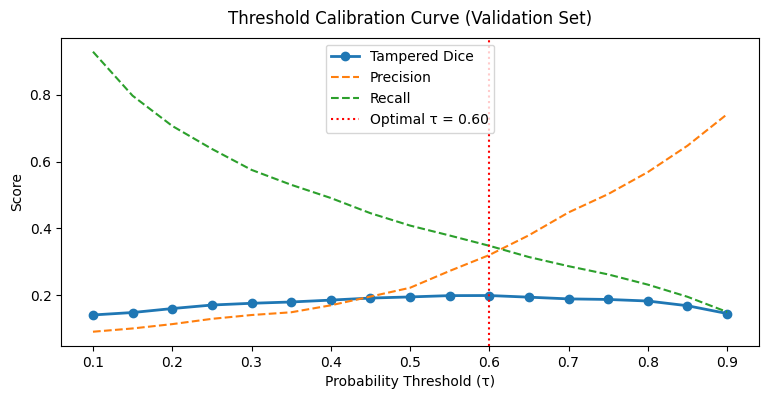
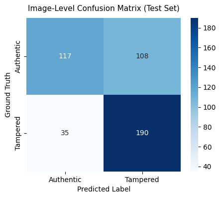
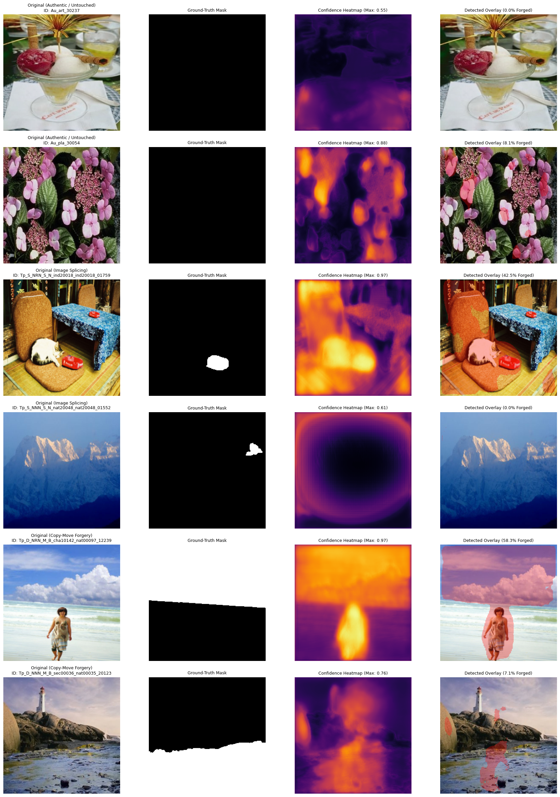

# AI-Based Document Forgery Detection (DocTamper / CASIA 2.0)

A modular, production-grade deep learning system for document manipulation detection and pixel-level tamper localization.

---

## 1. Project Overview

Digital document manipulation—including text replacement, signature splicing, copy-move forgery, and stamp erasure—poses severe risks to financial, legal, and governmental operations. This project establishes an end-to-end computer vision and forensic analysis pipeline benchmarked on the **DocTamper** and **CASIA 2.0** datasets.

### Target Model Explorations
1. **Pixel-Level Tamper Localization (Primary):** U-Net / Attention U-Net trained on composite loss (Dice + BCE) to segment modified document regions at pixel resolution.
2. **Document-Level Classification (Secondary):** Deep Convolutional Networks (ResNet-34/50) predicting overall document authenticity probability $P(\text{Tampered}) \in [0, 1]$.
3. **Self-Supervised Anomaly Reconstruction (Tertiary):** Convolutional Autoencoders trained exclusively on authentic document patches to localize tamper anomalies via high reconstruction error ($L_1 / \text{SSIM}$ residuals).

---

## 2. Repository Structure

```text
DocForgery/
├── .gitignore                   # Production-grade Git ignores (data, weights, environments)
├── AGENT_INSTRUCTIONS.md        # Collaboration rules & engineering standards
├── README.md                    # Project documentation & quickstart
├── requirements.txt             # Pinned dependencies with upper bounds
├── data/
│   ├── raw/                     # Original immutable datasets
│   │   ├── authentic/           # Untouched document samples
│   │   ├── tampered/            # Manipulated document samples
│   │   └── masks/               # Binary ground-truth tampering masks
│   └── processed/               # Preprocessed splits & ingestion manifest
│       ├── metadata.csv         # Structured tabular manifest
│       ├── train/               # Training image-mask pairs
│       ├── val/                 # Validation image-mask pairs
│       └── test/                # Test image-mask pairs
├── docs/
│   └── DECISIONS.md             # Architecture Decision Records (ADRs)
├── flask_app/                   # Web serving application
│   ├── app.py                   # Serving endpoints & inference staging
│   ├── static/                  # Static assets (CSS, JS, uploads, outputs)
│   └── templates/               # UI templates for document comparison
├── models/
│   └── checkpoints/             # Exported model weights (.pt, .pth)
├── notebooks/                   # Sequential experimental analysis
│   ├── 01_data_exploration_preprocessing.ipynb
│   ├── 02_model_training_baseline.ipynb
│   └── 03_evaluation_metrics_inference.ipynb
├── src/                         # Reusable production source modules
│   ├── config.py                # Typed dataclass runtime configuration
│   ├── dataset.py               # Custom PyTorch Dataset with ELA & Albumentations
│   ├── models/                  # Architecture definitions (ResNet, U-Net, Autoencoder)
│   ├── train.py                 # Training loops, loss formulation, checkpointer
│   └── utils.py                 # Metrics (IoU, Pixel-F1), ELA, and visual overlays
└── tests/                       # Automated unit & integration test suite
```

---

## 3. Environment Setup

### Prerequisites
- Python 3.10+ (Recommended: Python 3.10 or 3.11)
- CUDA 11.8 / 12.1 compatible GPU (optional, CPU fallback supported)

### Installation
```bash
# 1. Create virtual environment
python -m venv venv

# 2. Activate virtual environment
# Windows (PowerShell):
.\venv\Scripts\Activate.ps1
# Linux/macOS:
source venv/bin/activate

# 3. Install pinned dependencies
pip install --upgrade pip
pip install -r requirements.txt
```

---

## 4. Pipeline Workflow

1. **Exploration & Preprocessing:**
   Load raw datasets into `data/raw/`, run Error Level Analysis (ELA) and frequency inspections, and generate `data/processed/metadata.csv` using `notebooks/01_data_exploration_preprocessing.ipynb`.
2. **Model Training:**
   Execute baseline training for localization and classification via `src/train.py` or interactively in `notebooks/02_model_training_baseline.ipynb`.
3. **Evaluation & Benchmarking:**
   Compute Pixel-F1, Intersection-over-Union (IoU), and ROC-AUC metrics via `notebooks/03_evaluation_metrics_inference.ipynb`.
4. **Interactive Inspection:**
   Launch the Flask serving interface (`flask_app/app.py`) for side-by-side visualization of authentic vs. tampered document heatmaps.


   ## Evaluation & Qualitative Results

### 1. Optimal Threshold Sweeping & Metrics



### 2. Qualitative Tamper Localization

